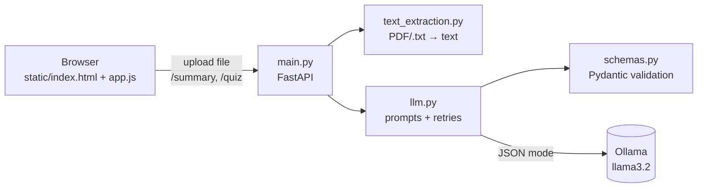

# Study Assistant

Upload your lecture notes (PDF or `.txt`) and get:

- a **summary**: a few short paragraphs plus a list of key concepts
- an **interactive multiple-choice quiz**, one question at a time, with explanations and a final score

Everything runs on your own computer using [Ollama](https://ollama.com) and a small local language model (`llama3.2` by default). No API key, and your notes never leave your machine.

## How it works



1. The browser uploads a file to `main.py`.
2. `text_extraction.py` turns it into plain text, shortening it if it's too long.
3. `llm.py` sends the text and a prompt to Ollama and asks for JSON.
4. The JSON is checked against the models in `schemas.py`. If it's wrong, `llm.py` asks the model again.
5. `main.py` sends the result back to the browser, which shows the summary or quiz.

| File | What it does |
|---|---|
| `main.py` | The web server: API endpoints, error handling, serves the frontend |
| `llm.py` | **All** language-model code. Swap this file to use another provider |
| `text_extraction.py` | Reads PDFs (with `pypdf`) and text files, shortens long text |
| `schemas.py` | Pydantic models that validate the model's JSON and describe the API |
| `static/` | The frontend: `index.html`, `style.css`, `app.js` |
| `samples/` | A small example lecture to test with |

**Why validation and retries?** Small local models sometimes return JSON with missing fields, the wrong number of options, and similar mistakes. `llm.py` checks every answer with Pydantic. If it's wrong, the error is sent back to the model and it gets up to two more tries.

## Setup

You need **Python 3.10 or newer**.

### 1. Install Ollama

Download and install it from <https://ollama.com/download> (macOS, Windows, Linux).
On macOS you can also use Homebrew: `brew install ollama`.

Make sure it's running: open the Ollama app, or run this in a terminal:

```bash
ollama serve
```

### 2. Download the model

```bash
ollama pull llama3.2
```

This downloads about 2 GB. You can check which models you have with `ollama list`.

### 3. Create a virtual environment and install dependencies

A virtual environment keeps this project's packages separate from the rest of your computer.

```bash
cd studassummary
python3 -m venv .venv

# Activate it (do this every time you open a new terminal):
source .venv/bin/activate        # macOS / Linux
# .venv\Scripts\activate         # Windows

pip install -r requirements.txt
```

### 4. Configure (optional)

```bash
cp .env.example .env
```

Edit `.env` to change the model, for example `OLLAMA_MODEL=llama3.1:8b` (remember to `ollama pull` it first). Bigger models give better results but are slower.

### 5. Run the app

```bash
uvicorn main:app --reload
```

- Open the app at <http://localhost:8000>
- Try the API directly at <http://localhost:8000/docs>

`--reload` restarts the server automatically when you change the code.

Try it with `samples/photosynthesis.txt`.

## API

| Method | Path | Input | Returns |
|---|---|---|---|
| `POST` | `/summary` | `file` | `paragraphs`, `key_concepts`, `text_info` |
| `POST` | `/quiz` | `file`, `num_questions` (1–15, default 5), `difficulty` (`easy` / `medium` / `hard`) | `questions` (each with `question`, `options` (4), `correct_index` (0–3), `explanation`), `text_info` |
| `GET` | `/health` | — | Whether Ollama and the model are available |

`text_info.truncated` is `true` when the document was too long and only its first part was used (`text_info.notice` explains this).

Example with `curl`:

```bash
curl -F "file=@samples/photosynthesis.txt" -F num_questions=3 -F difficulty=easy http://localhost:8000/quiz
```

Errors come back as `{"detail": "..."}` with a clear message:

| Status | When |
|---|---|
| 400 | Empty file or invalid PDF |
| 413 | File larger than 20 MB |
| 415 | Not a `.pdf` or `.txt` file |
| 422 | No text in the file (e.g. a scanned PDF), or invalid parameters |
| 502 | The model kept returning invalid JSON after 3 attempts |
| 503 | Ollama isn't running, or the model isn't downloaded |

## Troubleshooting

- **"Could not connect to Ollama"**: start the Ollama app or run `ollama serve`.
- **"The model 'llama3.2' is not downloaded"**: run `ollama pull llama3.2`.
- **"No text could be extracted from this PDF"**: the PDF is probably scanned images. Try a PDF where you can select the text, or run OCR on it first.
- **Slow answers**: a summary usually takes 5–30 seconds and a quiz 10–60 seconds, depending on your computer. The first request after starting also has to load the model into memory.
- **Only part of my document was used**: small models can only read a limited amount of text. Raise `MAX_INPUT_CHARS` in `.env` carefully, or upload one chapter at a time.

## Using a different model provider

All LLM code is in `llm.py`. To use a paid API instead, rewrite `_chat_json()` (send messages, return the JSON text) and `check_status()`. The prompts, validation, retries and the rest of the app stay the same.
